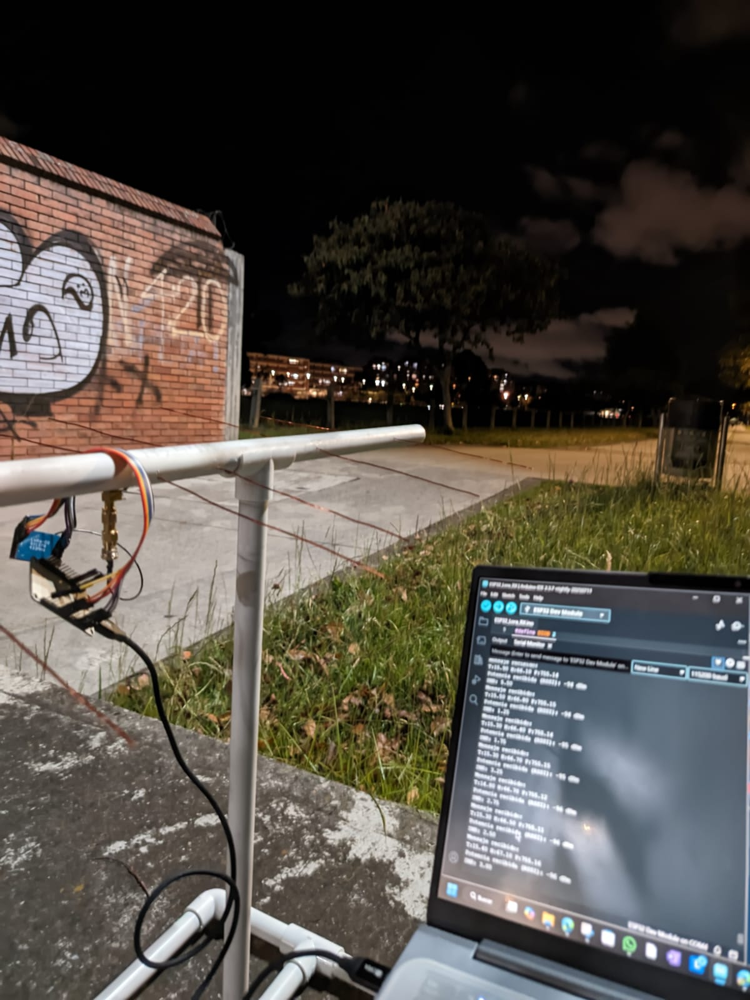

# Proyecto Antenas — Enlace RF LoRa a 433 MHz con Antena Direccional Yagi-Uda

Sistema embebido de telemetría ambiental de largo alcance en la banda ISM de **433 MHz** utilizando microcontroladores **ESP32**, transceptores **SX1278 LoRa** con modulación **Chirp Spread Spectrum (CSS)**, sensores **BMP280** (`I2C`) y **DHT11**, y antena direccional **Yagi-Uda** para validación de enlace en campo.

---

## Parámetros de Modulación LoRa y Presupuesto de Enlace

### Configuración del Transceptor (`SX1278`)

| Parámetro | Valor Configurado | Impacto en Capa Física |
| :--- | :---: | :--- |
| **Frecuencia portadora ($f_c$)** | `433 MHz` | Menor pérdida de propagación en espacio libre frente a 915 MHz / 2.4 GHz |
| **Potencia de transmisión ($P_{\text{TX}}$)** | `20 dBm` (`100 mW`) | Amplificador de potencia `PA_BOOST` activo |
| **Spreading Factor ($\text{SF}$)** | `12` | Ganancia de procesamiento $G_p = 10\log_{10}(2^{12}) = 36.12\text{ dB}$, límite $\text{SNR} = -20\text{ dB}$ |
| **Ancho de banda ($\text{BW}$)** | `125 kHz` | Tasa de símbolo $R_s = 30.52\text{ sps}$, duración de símbolo $T_{\text{sym}} = 32.77\text{ ms}$ |
| **Coding Rate ($\text{CR}$)** | `4/8` | Máxima redundancia Hamming para corrección de errores (`183.11 bps` nominal) |
| **Sensibilidad teórica RX ($S_{\text{RX}}$)** | `-137.03 dBm` | Calculada con figura de ruido típica $\text{NF} = 6.0\text{ dB}$ |

### Ecuaciones del Modelo (`rf_link_budget.py`)

* **Pérdida en Espacio Libre (FSPL):**
  $$\text{FSPL (dB)} = 20\log_{10}(d_{\text{km}}) + 20\log_{10}(f_{\text{MHz}}) + 32.44$$
* **Radio de Primera Zona de Fresnel (punto medio):**
  $$F_1\text{ (m)} = 8.657\sqrt{\frac{d_{\text{km}}}{f_{\text{GHz}}}}$$
* **Potencia recibida estimada (Yagi RX = $9\text{ dBi}$, dipolo TX = $2.15\text{ dBi}$, pérdidas de cable $L_c = 1.5\text{ dB}$):**

| Distancia ($d$) | FSPL | $P_{\text{RX}}$ | Sensibilidad RX | Margen de Enlace | Despeje $60\%\,F_1$ | Time-on-Air (24 B) |
| :---: | :---: | :---: | :---: | :---: | :---: | :---: |
| `0.5 km` | `79.15 dB` | `-49.50 dBm` | `-137.03 dBm` | `+87.53 dB` | `5.58 m` | `1974.27 ms` |
| `1.0 km` | `85.17 dB` | `-55.52 dBm` | `-137.03 dBm` | `+81.51 dB` | `7.89 m` | `1974.27 ms` |
| `5.0 km` | `99.15 dB` | `-69.50 dBm` | `-137.03 dBm` | `+67.53 dB` | `17.65 m` | `1974.27 ms` |
| `10.0 km` | `105.17 dB` | `-75.52 dBm` | `-137.03 dBm` | `+61.51 dB` | `24.96 m` | `1974.27 ms` |
| `20.0 km` | `111.19 dB` | `-81.54 dBm` | `-137.03 dBm` | `+55.49 dB` | `35.30 m` | `1974.27 ms` |

---

## Arquitectura Hardware y Pinout

### Nodo Transmisor (`ESP32_Lora_TX.ino`)

| Módulo / Sensor | Interfaz | Pines ESP32 | Variable Medida / Función |
| :--- | :---: | :--- | :--- |
| **SX1278 LoRa (433 MHz)** | `SPI` | `SS=GPIO5`, `RST=GPIO14`, `DIO0=GPIO2` | Transmisión de paquetes telemétricos (`20 dBm`) |
| **BMP280** | `I2C` | `SDA=GPIO21`, `SCL=GPIO22` | Presión barométrica ($\text{hPa}$) |
| **DHT11** | Digital 1-Wire | `DATA=GPIO4` | Temperatura ($^\circ\text{C}$) y humedad relativa ($\%$) |
| **LED Indicador** | `GPIO` | `GPIO27` | Estado de inicialización LoRa |

### Nodo Receptor (`ESP32_Lora_RX.ino`)

| Módulo | Interfaz | Pines ESP32 | Salida Diagnóstica |
| :--- | :---: | :--- | :--- |
| **SX1278 LoRa + Yagi-Uda** | `SPI` | `SS=GPIO5`, `RST=GPIO14`, `DIO0=GPIO2` | Payload ambiental, `RSSI` ($\text{dBm}$) y `SNR` ($\text{dB}$) por puerto serie a `115200 bps` |

---

## Diagramas de Conexión y Prueba de Campo

| Nodo Transmisor (`TX`) | Nodo Receptor (`RX`) |
| :---: | :---: |
|  |  |



---

## Correcciones Técnicas y Verificación

* Se corrigió en `ESP32_Lora_TX.ino` el argumento de `LoRa.setTxPower(0.0001, PA_OUTPUT_PA_BOOST_PIN)` (que truncaba el entero a `0 dBm` en C++) por `LoRa.setTxPower(20, PA_OUTPUT_PA_BOOST_PIN)` correspondiente a `20 dBm (100 mW)`.
* Ejecución del analizador de enlace RF y pruebas unitarias:

```bash
python rf_link_budget.py
python -m unittest discover -s tests -v
```
